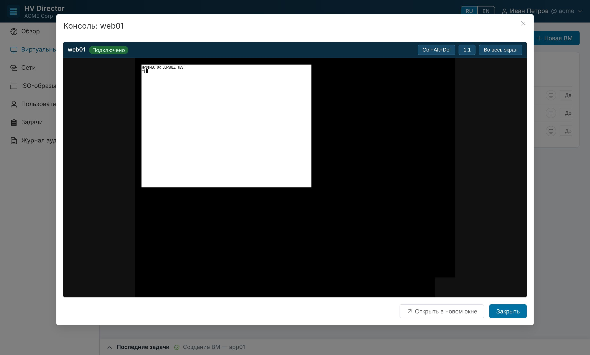
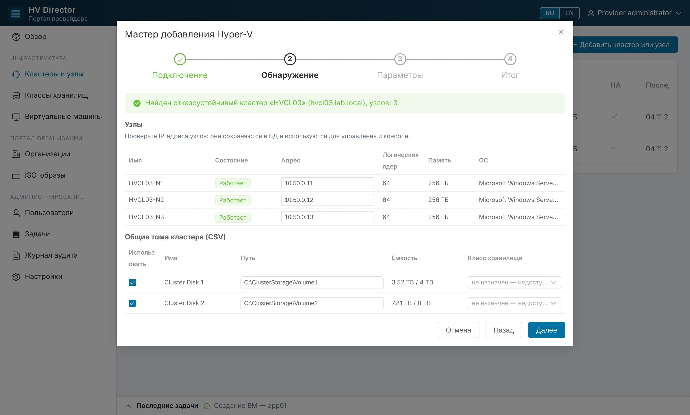
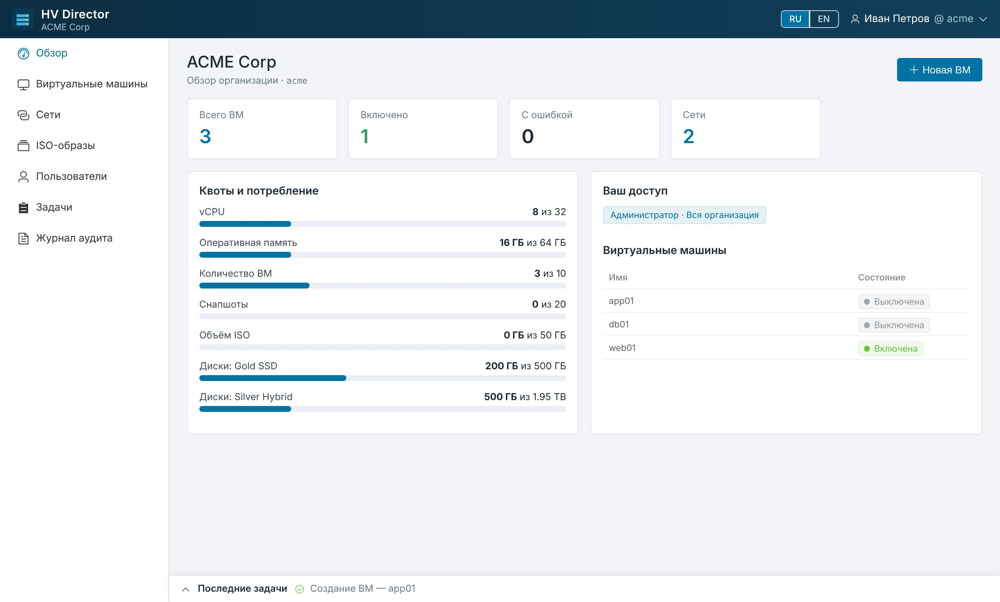

# HV Director

Мультитенантный портал самообслуживания для кластеров Microsoft Hyper-V — упрощённый аналог
VMware Cloud Director. Провайдер подключает кластеры или отдельные хосты, описывает классы хранилищ и
создаёт организации (тенанты) с квотами и пулом VLAN. Пользователи организаций сами создают ВМ, сети,
загружают ISO, делают снапшоты и открывают консоль ВМ в браузере.

*English: [README.en.md](README.en.md)*



| Мастер добавления кластера | Обзор организации |
|---|---|
|  |  |

*Скриншоты сняты в режиме симулятора Hyper-V (`HVD_HYPERV_DRIVER=fake`).*

## Возможности

| # | Требование | Реализация |
|---|------------|------------|
| 1 | База данных PostgreSQL | PostgreSQL 17 (Debian 13), схема через Alembic-миграции |
| 2 | Мастер добавления кластера или узла, опрос состава, Refresh | Мастер: подключение по WinRM → автоопределение кластер/отдельный хост → узлы с IP, CSV, коммутаторы → параметры → итог. Кнопка «Опросить (Refresh)» показывает добавленные и исключённые узлы |
| 3 | Тенант, квоты, локальные пользователи, роли, делегирование на ВМ | Квоты: vCPU, RAM, число ВМ, объём ISO, число снапшотов и **диск по каждому классу хранилища** (Gold/Silver/…). Роли `tenant_admin`, `audit`, `console` назначаются на всю организацию или на конкретную ВМ |
| 4 | Вход тенанта, операции с ВМ, выход | `/tenant/<код>/login`; создание, включение, завершение работы, выключение питания, перезагрузка ОС, аппаратный сброс, удаление, снапшоты (создание, откат, удаление), ISO; изменение vCPU, памяти (у включённой ВМ — «на лету»), **расширение и удаление дисков**, добавление дисков, добавление/удаление сетевых адаптеров и смена их сети |
| 5 | Консоль через фрагмент Apache Guacamole, порт 2179, iframe во всплывающем окне | guacamole-common-js в iframe; WebSocket-туннель бэкенда → guacd → RDP `vmconnect` на узел-владелец ВМ:2179 с VMId в preconnection BLOB. Креды хоста в браузер не передаются; одноразовые тикеты |
| 6, 7 | L2-underlay, VLAN из конфигуратора тенанта, сеть занимает VLAN | Провайдер выдаёт организации диапазоны VLAN (`100-110,120`), без пересечений между организациями. Сеть организации занимает один свободный VLAN; адаптеры ВМ в этой сети получают `Set-VMNetworkAdapterVlan -Access` |
| 8 | Загрузка ISO на `\\shared\iso`, уникальное имя с GUID | Загрузка частями по 16 МБ напрямую на SMB-шару (smbprotocol, без монтирования); имя `<GUID>_<исходное имя>.iso`; квота на объём; общий каталог провайдера |
| 9 | Интерфейс ru/en | Переключатель RU/EN в шапке, выбор сохраняется в профиле |
| 10 | Привязка тенанта к кластеру, авторазмещение + HA | Организация привязана к кластеру. ВМ создаётся на узле с наибольшим запасом свободной памяти и регистрируется ролью кластера (`Add-ClusterVirtualMachineRole`). Перемещение ВМ (live migration, failover) отслеживается автоматически |
| 11 | Всё на одной машине без Docker | `deploy/install.sh` ставит PostgreSQL, nginx, Python venv, guacd (сборка из исходников), systemd-юниты |
| 12 | Все креды и IP в БД | В БД: адреса узлов и кластера, учётные данные WinRM, консоли и шары ISO (шифрование Fernet), адрес guacd. Вне БД только строка подключения к PostgreSQL и мастер-ключ |
| 14 | Графики загрузки ВМ | Вкладка «Мониторинг»: CPU, память (выделено / потребность гостя), диск (чтение, запись, IOPS), сеть (приём, передача) за 1 ч … 30 дней, текущие значения, таблица. Сбор раз в минуту с узлов Hyper-V (счётчики гипервизора и resource metering), хранение 14 дней (настраивается) |
| 15 | Управление ВМ провайдером | Карточка ВМ у провайдера: включение/выключение, перезагрузка, сброс, консоль, изменение vCPU/памяти/дисков/адаптеров, графики. Действуют квоты организации; задачи видны организации, всё пишется в журнал аудита |
| 13 | Виртуальные раутеры (Edge) | Раутер организации — ВМ с Debian 13, ставится автоматически из ISO провайдера (preseed, xorriso). Management в глобальной таблице (SSH от HV Director), WAN и сети тенанта в VRF; сети подключаются VLAN-интерфейсами (SVI) на trunk. Firewall stateful/stateless, SNAT/DNAT, списки IP, явные TCP/UDP-порты, DHCP-сервер в сетях (пул, DNS/NTP, статические привязки, просмотр аренд). Подробнее: [docs/routers.md](docs/routers.md) |

## Архитектура

```
 Браузер (Vue 3 + Element Plus, ru/en)            Debian 13, одна машина
 ┌────────────────────────────┐   HTTPS   ┌─────────────────────────────────────────────┐
 │ портал провайдера / тенанта│──────────▶│ nginx :443 ─┬─ статика UI (frontend/dist)   │
 │ iframe консоли             │◀──WSS────▶│             └─ /api, /ws → uvicorn :8000    │
 │  (guacamole-common-js)     │           │ hvdirector-api  (FastAPI)                   │
 └────────────────────────────┘           │   ├─ PostgreSQL 17 (данные, задачи, аудит)  │
                                          │   └─ /ws/console ──TCP──▶ guacd :4822       │
                                          │ hvdirector-worker (очередь задач, синхр.)   │
                                          └───────┬───────────────┬───────────┬─────────┘
                                   WinRM 5985/5986│      SMB 445  │  RDP 2179 │ (guacd)
                                                  ▼               ▼           ▼
                               узлы Hyper-V (кластер / хост)   \\shared\iso   узел-владелец ВМ
```

* **hvdirector-api** — REST API и WebSocket-туннель консоли. Сессии в БД (HttpOnly-cookie + CSRF-токен).
* **hvdirector-worker** — выполняет операции Hyper-V фоновыми задачами (очередь в PostgreSQL,
  `FOR UPDATE SKIP LOCKED`, задачи одной ВМ выполняются последовательно) и раз в минуту
  синхронизирует состояние ВМ и узлов.
* **Драйвер Hyper-V** — PowerShell-скрипты (`backend/hvdirector/hyperv/scripts/*.ps1`), выполняемые через
  pypsrp (PSRP поверх WinRM; NTLM, Negotiate, Kerberos, CredSSP, Basic/HTTPS). Параметры передаются
  одним JSON-аргументом, в текст скрипта ничего не подставляется. Операции над ВМ выполняются на узле,
  которым ВМ владеет сейчас, поэтому для локальных путей CSV двойной переход не нужен.
* **guacd 1.6.0** собирается из исходников с FreeRDP 3 (в Debian 13 нет пакета guacd).

## Установка (Debian 13)

```bash
git clone https://github.com/eugenezhukov/hvdirector.git
```

```bash
cd hvdirector
```

```bash
sudo ./deploy/install.sh --hostname hvdirector.corp.local
```

Скрипт:

1. ставит `postgresql`, `nginx`, `python3-venv`, создаёт пользователя `hvdirector`;
2. копирует приложение в `/opt/hvdirector/app`, создаёт venv и ставит зависимости (`backend/requirements.txt`);
3. генерирует `/etc/hvdirector/hvdirector.env` (пароль БД и мастер-ключ), создаёт роль и базу PostgreSQL,
   применяет миграции и создаёт первого администратора провайдера (пароль выводится в конце);
4. собирает **guacd 1.6.0** с RDP (FreeRDP 3) — `deploy/build-guacd.sh`, слушает только `127.0.0.1:4822`;
5. выпускает самоподписанный TLS-сертификат (`/etc/hvdirector/tls/`, замените своим) и настраивает nginx;
6. включает службы `hvdirector-api`, `hvdirector-worker`, `hvdirector-guacd`.

Повторный запуск обновляет приложение (конфигурация и данные сохраняются). Опции:
`--skip-guacd`, `--rebuild-guacd`, `--build-ui` (пересобрать UI через Node.js — по умолчанию используется
собранный `frontend/dist`), `--demo` (встроенный симулятор Hyper-V вместо реальных хостов).

Сетевые порты: входящий 443/80 на портал; исходящие 5985/5986 и 2179 к узлам Hyper-V, 445 к файловому
серверу с шарой ISO.

**Резервное копирование:** `pg_dump hvdirector` + файл `/etc/hvdirector/hvdirector.env` (без мастер-ключа
сохранённые пароли не расшифровать).

Полезные команды:

```bash
sudo -u hvdirector bash -c 'set -a; . /etc/hvdirector/hvdirector.env; /opt/hvdirector/venv/bin/hvdirector-manage check'
```

```bash
sudo -u hvdirector bash -c 'set -a; . /etc/hvdirector/hvdirector.env; /opt/hvdirector/venv/bin/hvdirector-manage reset-password --username admin'
```

```bash
journalctl -u hvdirector-api -u hvdirector-worker -u hvdirector-guacd -f
```

## Виртуальные раутеры

Провайдер описывает внешние сети (WAN и OOB management), выдаёт организации WAN-адреса и management IP и выбирает ISO Debian 13; тенант создаёт раутер кнопкой, подключает к нему свои сети и настраивает firewall, NAT, списки IP и DHCP-сервер сетей. Архитектура, сетевые требования и семантика правил — в **[docs/routers.md](docs/routers.md)**.

## Подготовка Hyper-V

См. **[docs/hyperv-setup.md](docs/hyperv-setup.md)**: сервисная учётная запись, WinRM, порт 2179,
коммутатор для VLAN, хранилища CSV/SMB3, права на `\\shared\iso` и варианты решения double hop (CredSSP).

## Первые шаги провайдера

1. **Настройки → Шара ISO-образов**: UNC-путь `\\shared\iso`, учётная запись с правом записи, «Проверить».
2. **Классы хранилищ**: например, `Gold SSD` (tier 1) и `Bronze HDD` (tier 3).
3. **Кластеры и узлы → Добавить**: адрес любого узла (или отдельного хоста), учётная запись, транспорт WinRM.
   Мастер покажет найденный кластер, узлы с IP-адресами (их можно поправить: IP сохраняются в БД и
   используются для управления и консоли), CSV, общие для всех узлов коммутаторы. Назначьте CSV классы
   хранилищ, выберите коммутатор для сетей тенантов и включите HA.
4. **Организации → Новая организация**: код (используется при входе и в имени ВМ), кластер размещения, квоты,
   квоты дисков по классам, VLAN (`100-110,120`), первый администратор организации.
5. Отправьте администратору организации адрес `https://<портал>/tenant/<код>/login`.

Кнопка **«Опросить (Refresh)»** в карточке кластера заново опрашивает состав: новые узлы добавляются
(с IP из кластерной сети), исключённые помечаются «Исключён из кластера» (их можно удалить), обновляются
CSV, ресурсы узлов и состояния ВМ. Узел можно перевести в «Обслуживание» — он перестанет использоваться
для размещения новых ВМ.

## Портал организации

* **Сети** — сеть занимает свободный VLAN из пула организации (автоматически или выбранный вручную);
  CIDR/шлюз/DNS — справочные поля.
* **ISO-образы** — загрузка с прогрессом и повтором частей; видны собственные образы и общий каталог провайдера.
* **Виртуальные машины** — мастер создания (поколение 1/2, Secure Boot, vCPU, RAM, диски по классам
  хранилищ, адаптеры по сетям, ISO, включение после создания), операции питания, снапшоты, ISO, изменение
  оборудования, консоль во всплывающем окне (Ctrl+Alt+Del, полноэкранный режим, «Открыть в новом окне»).
* **Пользователи** — локальная база пользователей организации и роли.
* **Задачи** и **Журнал аудита** — все операции с инициатором, результатом и IP.

### Роли

| Право | tenant_admin | audit | console |
|-------|:-----------:|:-----:|:-------:|
| Просмотр ВМ | ✔ | ✔ | ✔ |
| Консоль ВМ | ✔ | — | ✔ |
| Питание, снапшоты, ISO, изменение, удаление ВМ | ✔ | — | — |
| Создание ВМ, сети, ISO, пользователи | ✔ (на всю организацию) | просмотр | — |
| Квоты, задачи, журнал аудита | ✔ | ✔ | только свои задачи |

Роль назначается **на всю организацию** или **на конкретную ВМ** (делегирование). Например, «console» на ВМ
`web01` даёт пользователю доступ только к этой ВМ и её консоли, а `tenant_admin` на ВМ — полное управление
только этой машиной. В организации всегда остаётся хотя бы один администратор.

### Как считаются квоты

* vCPU, RAM, число ВМ — по всем ВМ организации независимо от их состояния;
* диск — по выделенному (provisioned) объёму VHDX, отдельно для каждого класса хранилища;
  класс без квоты организации недоступен;
* снапшоты — общее число снапшотов всех ВМ организации;
* ISO — суммарный объём собственных образов (общий каталог провайдера не учитывается).

Проверка квоты выполняется под блокировкой строки организации, поэтому параллельные запросы её не превысят.

## Безопасность

* Пароли пользователей — Argon2; учётные данные Hyper-V и шары в БД — Fernet (AES-128-CBC + HMAC)
  с мастер-ключом из `/etc/hvdirector/hvdirector.env`.
* Сессии хранятся в БД (HttpOnly, Secure, SameSite=Lax), CSRF-токен в заголовке, тайм-аут неактивности,
  блокировка после неудачных входов и ограничение частоты попыток входа.
* Консоль: одноразовый тикет на 60 секунд, привязанный к пользователю и ВМ, плюс проверка сессии на WebSocket.
  guacd слушает только localhost.
* Права проверяются на сервере для каждой операции, а изоляция организаций обеспечивается на уровне запросов.

## Разработка

```bash
cd backend && python3 -m venv .venv && .venv/bin/pip install -e '.[dev]'
```

Режим симулятора (`HVD_HYPERV_DRIVER=fake`) позволяет запускать весь портал без Hyper-V: в мастере любой адрес
превращается в кластер из трёх узлов (последний октет ≥ 200 — отдельный хост, пароль `wrong` — ошибка
аутентификации). Состояние симулятора меняется командами `hvdirector-manage fake add-node|remove-node|migrate`.
Консоль симулятора подключается к VNC-серверу из `HVD_FAKE_VNC`.

```bash
cd backend && .venv/bin/pytest
```

Тестам нужна PostgreSQL-база `hvdirector_test` (`HVD_TEST_DATABASE_URL`); сквозной сценарий проходит через API:
кластер, тенант, сети и VLAN, ISO, квоты, ВМ, снапшоты, делегирование, Refresh, миграция ВМ, удаление.

```bash
cd frontend && npm ci && npm run dev
```

Vite проксирует `/api` и `/ws` на `127.0.0.1:8000`. Сборка `npm run build` кладёт UI в `frontend/dist`
(собранная версия хранится в репозитории, чтобы на сервере не требовался Node.js).

Структура:

```
backend/hvdirector/   FastAPI-приложение, модели, сервисы, воркер, драйвер Hyper-V (+ PowerShell), миграции
frontend/             Vue 3 SPA (портал провайдера и тенанта) и страница консоли console.html
deploy/               install.sh, build-guacd.sh, systemd-юниты, конфигурация nginx
docs/                 подготовка Hyper-V
```

## Ограничения текущей версии

* ВМ создаются «с нуля» (диск + ISO); шаблоны и клонирование не реализованы.
* Память статическая (Dynamic Memory не используется), квота считается по выделенной памяти.
* Без раутера IP-адресация сетей справочная (без IPAM/DHCP); маршрутизация между VLAN — на стороне сети или раутера.
* Провайдер управляет питанием и параметрами ВМ организаций, но не создаёт и не удаляет их от имени организации.
* Раутеры: один на организацию, IPv4, без VPN и статических маршрутов; DHCP — один пул на сеть (см. docs/routers.md).
* Сборка guacd проверена с FreeRDP 3 на Ubuntu 24.04. На Debian 13 используются те же флаги сборки,
  но установщик на чистом Debian 13 в рамках этой разработки не запускался.
